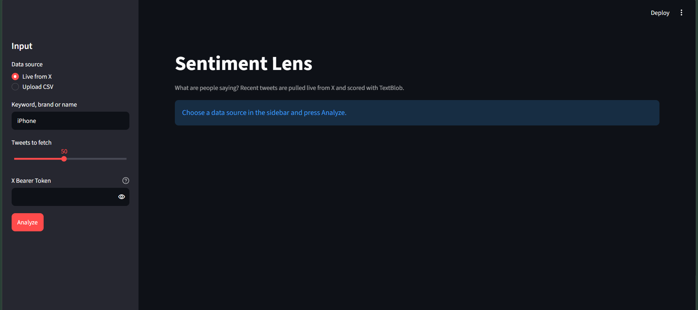
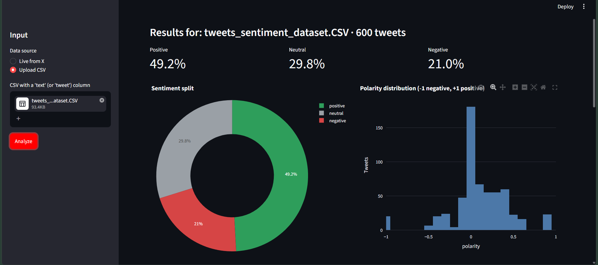
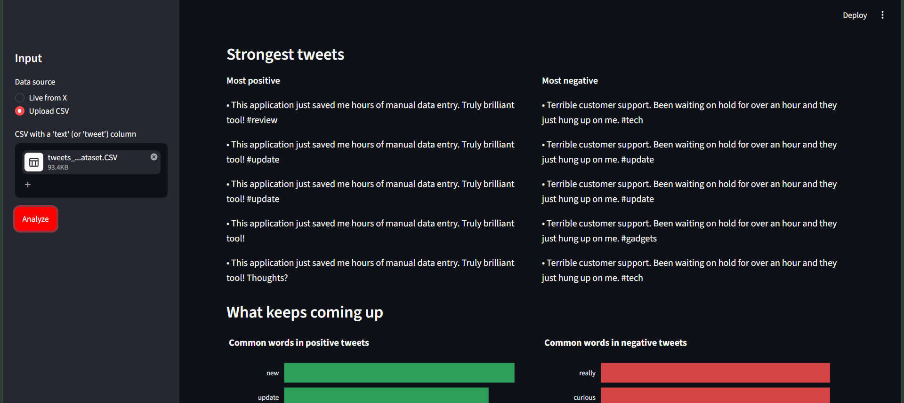
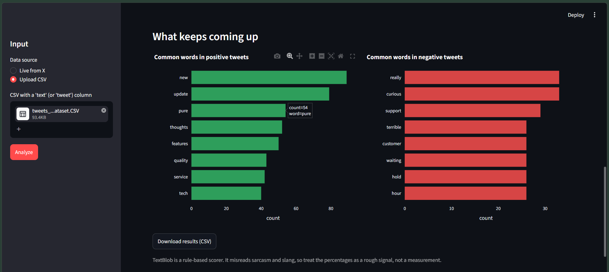

# Sentiment Lens 📊

An interactive Natural Language Processing (NLP) web dashboard that evaluates public opinion, brand perception, and social sentiment from live X (formerly Twitter) streams and offline batch CSV datasets.

---

## 📸 Visual Dashboard Proof

### 1. Dashboard Interface & Ingestion Setup
Clean user interface featuring dynamic query toggles, keyword selection, and in-app secure X API Bearer Token configuration.



### 2. Sentiment Split & Polarity Distribution
Real-time breakdown of sentiment proportions (Positive / Neutral / Negative) alongside polarity score distribution (-1.0 to +1.0) on a 600-record dataset.



### 3. Strongest Polarized Tweets
Instant extraction and display of the highest-polarity positive and lowest-polarity negative statements.



### 4. Recurring Keyword Frequency Analysis & Export
Term-frequency ranking isolating key drivers behind customer praise and complaints, paired with a one-click CSV export for downstream reporting.



---

## 🚀 Key Features

* **Dual-Ingestion Architecture:**
  * **Live X Streaming:** Ingests live English tweets via Tweepy and the X API v2 using direct in-app Bearer Token authentication or local environment variables.
  * **Offline Batch Ingestion:** Analyzes local CSV datasets with automated UTF-8 BOM (`\ufeff`) stripping and flexible column mapping (`text` or `tweet`).
* **Text Preprocessing & Sanitization Pipeline:** 
  * Regex-driven cleaning engine removing URLs, mentions (`@user`), hashtags, retweet tags, and non-ASCII noise.
* **Lexicon-Based Sentiment Engine:**
  * Uses TextBlob to calculate semantic polarity scores.
  * Implements an adjustable neutral-band threshold (`[-0.05, +0.05]`) to prevent slight fluctuations from distorting sentiment metrics.
* **Interactive Data Visualizations:**
  * Dynamic Plotly donut charts for macro sentiment proportions.
  * Polarity distribution histograms capturing score densities.
  * Horizontal bar charts ranking top recurring positive and negative keywords.
* **Data Export:** Direct download button to export processed and scored results as a clean CSV.

---

## 🛠️ Tech Stack

| Category | Technologies |
| :--- | :--- |
| **Language** | Python 3.10+ |
| **Frontend UI** | Streamlit |
| **Data Manipulation** | Pandas, Collections, Regex (`re`) |
| **NLP & Scoring** | TextBlob |
| **Data Visualization** | Plotly Express |
| **API Integration** | Tweepy (X API v2) |

---

## 📁 Repository Structure

```text
sentiment-lens/
├── app.py                      # Streamlit frontend & UI routing
├── sentiment_core.py           # Preprocessing, TextBlob scoring & Tweepy logic
├── requirements.txt            # Python dependencies
├── sample_tweets.csv           # Lightweight initial test dataset
├── tweets_sentiment_dataset.CSV # 600-record comprehensive test dataset
├── dashboard_overview.png      # UI landing & token setup screenshot
├── sentiment_distribution.png  # Donut & histogram visualization screenshot
├── strongest_tweets.png        # Polarized tweets screenshot
├── keyword_frequency.png       # Keyword frequency & export screenshot
├── .gitignore                  # Git ignore rules
└── README.md                   # Project documentation

```
## 💻 Local Setup & Execution

### 1. Clone Repository
```bash
git clone [https://github.com/Vineet0001/sentiment-lens.git](https://github.com/Vineet0001/sentiment-lens.git)
cd sentiment-lens
```

### 2. Create Virtual Environment
```bash
# Windows (PowerShell)
python -m venv venv
.\venv\Scripts\Activate.ps1

# Linux / macOS
python3 -m venv venv
source venv/bin/activate
```

### 3. Install Dependencies
```bash
pip install -r requirements.txt
python -m textblob.download_corpora
```

### 4. Run Application
```bash
streamlit run app.py
```
Open `http://localhost:8501` in your browser.

---

## 📖 How to Test

1. **Offline CSV Mode:**
   * Select **Upload CSV** in the sidebar.
   * Upload `tweets_sentiment_dataset.CSV`.
   * Click **Analyze** to process the 600 rows.
2. **Live X Mode:**
   * Select **Live from X** in the sidebar.
   * Enter a query keyword (e.g., `iPhone`, `AccuKnox`).
   * Enter your `X Bearer Token` in the sidebar password box.
   * Click **Analyze**.
